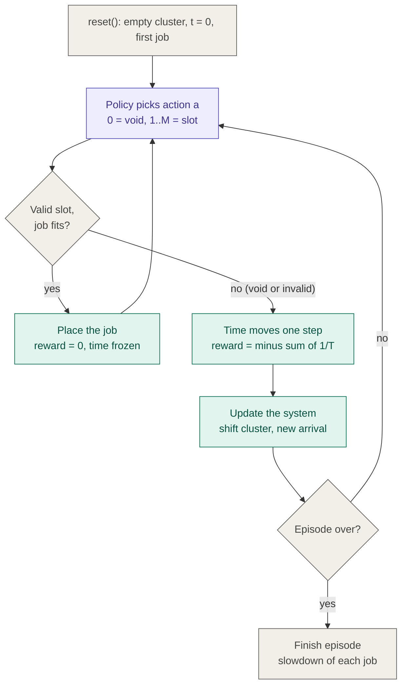

# How to run and verify Task 1 and Task 2

This guide is for a reader who has not seen the code before. Each step says what to run, what you should see, and what it means.

**Project in one line:** a cluster scheduler decides which waiting jobs to start. Paper: Mao et al. (2016), *Resource Management with Deep Reinforcement Learning* (DeepRM). Task 1 solves a small version of the problem exactly. Task 2 is a full simulator of the paper's cluster.

## 0. Setup (once)

```bash
python3 --version              # needs Python 3.8 or newer
python3 -m venv venv
source venv/bin/activate       # Windows: venv\Scripts\activate
pip install numpy matplotlib
```

Run every command below from the folder that contains `simulator.py`.

## 1. Task 1: small MDP solved by policy iteration

**File:** `task1_mdp_formulation_using_value_iteration.ipynb`.

```jupyter notebook
run the file in jupyter notebook to see the output
```

**Expected output:**

```
Iteration 1: Current Policy -> ['WAIT', 'START', 'WAIT', 'WAIT']
Iteration 2: Current Policy -> ['WAIT', 'START', 'WAIT', 'WAIT']

State                | Optimal Action  | State Value
FREE_NO_JOB          | WAIT            | -5.2556
FREE_JOB_WAITING     | START           | -6.4235
BUSY_NO_JOB          | WAIT            | -6.0895
BUSY_JOB_WAITING     | WAIT            | -7.0738
```

**The model it solves (one CPU, one waiting-job slot, job length 2):**

| State | Meaning |
|---|---|
| 0 FREE_NO_JOB | CPU idle, no job waiting |
| 1 FREE_JOB_WAITING | CPU idle, a job is waiting |
| 2 BUSY_NO_JOB | CPU running a job, no job waiting |
| 3 BUSY_JOB_WAITING | CPU running a job, another job waiting |

Actions are WAIT and START. START is only valid in state 1. Reward is -0.5 per job in the system per step (the paper's `-1/T` per job), plus an extra -0.5 for waiting while the CPU is idle and a job is waiting. The discount factor is 0.9.

**How to read the output:**
- **Iteration lines:** policy iteration alternates between evaluating a policy and improving it. It stops when the policy stops changing. Two iterations here means the first one found the best policy and the second one confirmed it.
- **State Value:** the expected total (discounted) penalty from that state if the best policy is followed. All numbers are negative because every job costs a penalty, so closer to zero is better. State 0 is best (no job in the system), and state 3 is worst (two jobs).
- **Optimal Action:** START is chosen only in state 1, which is the only state where a real choice exists. In the other three states START is not allowed, so both actions behave the same and the code prints WAIT.

**Optional check:** set `IDLE_CPU_PENALTY = 0` in the file and rerun. The policy becomes WAIT everywhere, which shows that this reward term is what makes the scheduler start jobs. The penalty and the 5% "job leaves" probability in the wait row are our own modelling choices, not from the paper.

## 2. Task 2: the cluster simulator




Four files, run in this order. Each one checks one more layer of the simulator.

| Step | Command | What it checks |
|---|---|---|
| 1 | `python3 simulator.py` | Cluster placement rule (hand example) |
| 2 | `python3 test_workload.py` | Job generator matches the paper's workload |
| 3 | `python3 test_env.py` | Reward is consistent with the objective |
| 4 | `python3 run_demo.py` | Full episode under two policies, with plots |

### Step 1: `simulator.py`

```
j1 starts at row offset: 1
CPU free after j1: [ 3  2  2 10 10 10]
j2 starts at row offset: 3
CPU free after advance: [ 2  2 10 10 10 10]
```

Meaning: the cluster is a table of free units per future timestep. Job 1 needs 4 CPU for 2 steps, but only 3 are free now, so it starts one step later. Placing it uses up 4 units in two rows (6 - 4 = 2). Job 2 needs 3 CPU for 3 steps, so it starts where three rows in a row have room. The last line shows time moving one step.

### Step 2: `test_workload.py`

```
arrival rate: ~0.70
fraction short (1-3): ~0.80
mean duration: ~4.1
mean demand per resource: ~[2.5 2.5]
dominant demands seen: [3, 4, 5]
```

Meaning: these are statistics over 100,000 timesteps, compared with the paper's workload (Sec. 4.1): jobs arrive with probability 0.7 per step, 80% last 1 to 3 steps and 20% last 10 to 15, giving a mean of 0.8 x 2 + 0.2 x 12.5 = 4.1. Small differences in the last digits are normal.

### Step 3: `test_env.py`

```
episode 0: jobs finished = 37, total reward = -199.875, sum slowdown = 199.875, min slowdown = 1.00, all done = True
...
check passed: total reward equals minus the sum of slowdowns
```

Meaning: each line is one full episode with random actions.
- `jobs finished`: jobs that arrived and completed (about 35 expected).
- `sum slowdown`: slowdown of a job is (completion time) / (job length), at least 1. The paper's objective is to minimise its average.
- `total reward`: the sum of the rewards given by the environment.
- The final line is the key check: total reward equals minus the sum of slowdowns, as the paper states in Sec. 3.2. It shows maximising reward and minimising slowdown are the same goal.

### Step 4: `run_demo.py`

```
Random : jobs finished = 37, average slowdown = 6.29, final cumulative reward = -232.9
SJF    : jobs finished = 37, average slowdown = 2.83, final cumulative reward = -104.7
saved sample_path.pdf and sample_path.png
```

Two policies face the **same 37 jobs** (same seed), so the comparison is fair.
- **Random:** picks any action at random, including empty slots.
- **SJF (Shortest Job First):** starts the shortest visible job that fits right now. This is a baseline heuristic from the paper.
- Lower slowdown is better, and reward closer to zero is better. Cross-check: 6.29 x 37 is about 233, and 2.83 x 37 is about 105.

**Reading the three graphs** in `sample_path.pdf` (x axis is the timestep in all three):

1. **Waiting jobs:** jobs that have arrived but not yet been started. Both lines rise while jobs arrive faster than they are served (peak near 10 at about timestep 20). SJF drains the queue to 0 by about timestep 57, whereas Random keeps one job waiting until about timestep 118. A long wait means that job's slowdown is large.
2. **Mean utilization:** the fraction of cluster units in use at that moment (averaged over CPU and memory). Both policies keep the cluster busy while there is work (0.5 to 1.0). Random is then mostly idle (0.0 to 0.3) while jobs still wait, which means it wasted capacity, and the episode drags on to about timestep 131 against about 72 for SJF.
3. **Cumulative reward:** the running total of the reward. It only goes down, because every waiting or running job costs a penalty each step. A steeper drop means more jobs are in the system. The two lines are nearly the same early on, when there are few jobs, and then separate once the queue builds. The final values are about -105 (SJF) and -233 (Random).

**What you can conclude:** the simulator behaves sensibly (a smarter rule gives a better score), and its reward matches the paper's objective.
**What you cannot conclude:** that SJF is better in general. This is one episode per policy, so it is a demonstration. A performance claim needs many episodes with confidence intervals, which belongs to the later part of the project.

## 3. Glossary

| Term | Meaning |
|---|---|
| Job | A task with an arrival time, a length (duration) and resource demands (CPU, memory) |
| Slowdown | (finish time - arrival time) / duration. 1 means the job never waited |
| Reward | At every step, minus the sum of 1/duration over all jobs in the system |
| Episode | One complete run: 50 timesteps of arrivals, then until every job finishes |
| Policy | A rule that picks an action in each state |
| Void action | "Stop scheduling this timestep". Time moves forward after it |
| SJF | Shortest Job First baseline |

## 4. Simplifications to know about

- Task 1 and the simulator are our simplifications (integer capacity of 10 units per resource, one-slot Task 1 model, backlog cap of 60 jobs from the paper not enforced).
- The paper's neural network agent and its training are **not** part of Tasks 1 and 2. They come in the later deliverables.

## 5. Troubleshooting

- `ImportError: cannot import name ...`: run the command from the folder that contains `simulator.py`, and make sure the file is saved.
- `ModuleNotFoundError: numpy` or `matplotlib`: run `pip install numpy matplotlib` inside the activated environment.
- Numbers differ slightly from this guide: the runs are seeded, so they should match closely. Small differences can come from different library versions.
